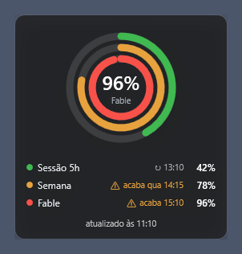
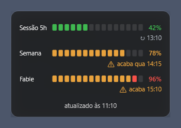

<h1 align="center">🟢 ClaudeWatch</h1>

  <a href="README.md">Português</a> ·
  <b>English</b> ·
  <a href="README.es.md">Español</a>

  <em>Keep an eye on your <b>Claude</b> subscription usage without breaking your flow — 
  a tidy, always-visible widget on your Windows desktop.</em>

  
  
  
  
  

  
  &nbsp;&nbsp;
  

The two styles: <b>Rings</b> and <b>LED</b> · 🟢 &lt;70% · 🟠 70–89% · 🔴 ≥90%

**ClaudeWatch** shows, in real time and at a glance, how much of your Claude limits you've used:

- 📅 **Weekly**, the limit every plan has
- ✨ **Per-model limits**, such as the weekly **Fable** limit
- ⏱️ **5-hour session**, on plans that still have it (verified Ultra accounts don't, and the card hides it)

…in a sleek floating card and a colored icon next to your clock. It gets your limits from the **Claude Code** you already have installed, through its official status line.

## ✨ Features

- 🎨 Four styles, picked from the tray menu: **Rings** (concentric, the critical limit in the center), **Bars** (with the Fable share inside the weekly bar), **Compact** (a pill; details open on hover) and **LED**
- 🧭 **Pace**: if a limit would run out before it resets at the current rate, the card warns in amber — `⚠ acaba dom 01:16`; otherwise it shows when it resets — `↻ seg 09:00`
- 🔢 Tray icon showing the most critical meter, colored by zone
- 🚦 Color by level: 🟢 green (&lt;70%) · 🟠 amber (70–89%) · 🔴 red (≥90%)
- 📌 Always on top, draggable, with a **locked** mode (click-through, stays out of your way)
- 🪟 Start with Windows (optional)
- 🔔 Notifies you when a new version is available
- 📦 A single `.exe` — no installer, no runtime

## 🔌 Where the data comes from

ClaudeWatch asks on first run, and you can switch later from the tray icon menu under **Fonte dos dados** (Data source):

- **Claude Code status line (default, official).** ClaudeWatch becomes Claude Code's status line and receives the 5-hour session and the week through the documented path. It never touches your token and never replaces a status line you already have.
- **Usage API (opt-in, unofficial).** Also brings the Fable limit and where your usage came from, but it calls an undocumented endpoint with the Claude Code token, and Anthropic's terms restrict that use.

The details are in [**How ClaudeWatch reads your limits**](LIMITS.en.md): each source's format, the pace math, and recipes to build your own status line.

## 📥 Install

1. Download `ClaudeWatch.exe` from the **[latest release](https://github.com/carlosdealmeida/claude-watch/releases/latest)**.
2. Double-click it.
3. On first run Windows shows a blue **SmartScreen** warning because the app is unsigned → click **"More info" → "Run anyway"**.

> 💡 Windows 11 hides new icons under the `^` arrow near the clock. Drag the ClaudeWatch icon out to keep it visible.

**Requirements:** Windows 10 or 11 · **Claude Code** installed and logged in (`claude` in the terminal).

## 🖱️ How to use

- **Double-click** the icon: show/hide the widget
- **Right-click** the icon opens the menu:
  - *Show/hide widget* · *Lock widget* · *Style: Rings / LED*
  - *Refresh now* · *Start with Windows* · *Exit*
- **Drag** the card while unlocked — its position is remembered

## 🚦 States

- **Grayed out + "⚠ updated at HH:mm"** — no internet or API down; showing the last known data.
- **🔒 "Log in to Claude Code"** — no valid credential; log in (`claude`) and the widget recovers on its own.

## 🔒 Privacy & security

- It **reads** Claude Code's `.credentials.json` but **never writes** to it — an absolute invariant.
- It uses the **same API** as Claude Code's `/usage` command.
- The token cache is protected by **DPAPI** (per-user Windows encryption).
- **No telemetry**: nothing goes to third parties — only the call to Anthropic's API.

## ⚠️ Limitations & disclaimer

ClaudeWatch is an **unofficial** project and is **not affiliated with Anthropic**. It relies on Claude Code's credential and API, so:

- It may **stop working** if Anthropic changes the API (without notice).
- Use it **personally and in moderation** — very frequent requests may be rate-limited (HTTP 429).
- Use it **at your own risk**.

## 🔄 Updates

Every few hours the app checks for a new version and notifies you via the tray icon, a Windows balloon, and a footer in the widget itself — just click to open the download page.

## 🗂️ Files & uninstall

- Settings: `%AppData%\ClaudeWatch\settings.json` · Logs: `%AppData%\ClaudeWatch\logs\`
- To remove: exit via the menu (*Exit*), uncheck *Start with Windows*, then delete the `.exe` along with the `%AppData%\ClaudeWatch` folder.

## 🛠️ For developers

Built with **.NET 10 + WPF**. Build with `dotnet build ClaudeWatch.slnx` and run the tests with `dotnet test ClaudeWatch.slnx`.

Released under the [MIT](LICENSE) license.

---

Personal, non-commercial project. Claude and Anthropic are trademarks of Anthropic — this project is not affiliated with or endorsed by them.

