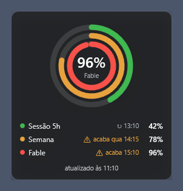
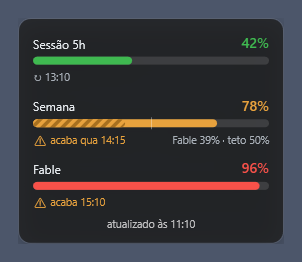
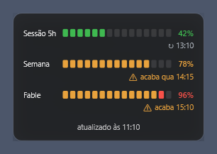
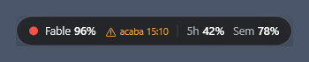

<h1 align="center">🟢 ClaudeWatch</h1>

  <a href="README.md">Português</a> ·
  <a href="README.en.md">English</a> ·
  <b>Español</b>

  <em>Controla el consumo de tu suscripción <b>Claude</b> sin salir de lo que estás haciendo — 
  un widget discreto, siempre a la vista, en tu escritorio de Windows.</em>

  
  
  
  
  

  
  &nbsp;&nbsp;
  

  
  &nbsp;&nbsp;
  

Los cuatro estilos: <b>Anillos</b>, <b>Barras</b>, <b>LED</b> y <b>Compacto</b> · 🟢 &lt;70% · 🟠 70–89% o se acaba antes del reinicio · 🔴 ≥90%

**ClaudeWatch** muestra, en tiempo real y de un vistazo, cuánto has usado de tus límites de Claude:

- 📅 **Semanal**, el límite que tiene todo plan
- ✨ **Límites por modelo**, como el semanal de **Fable**
- ⏱️ **Sesión de 5 horas**, en los planes que aún la tienen (en Ultra verificado no existe y la tarjeta la oculta)

…en una tarjeta flotante elegante y un icono de color junto al reloj. Recibe tus límites del **Claude Code** que ya tienes instalado, por su statusline oficial.

## ✨ Funciones

- 🎨 Cuatro estilos, elegidos en el menú de la bandeja: **Anillos** (concéntricos, el límite crítico en el centro), **Barras** (con la parte de Fable dentro de la semanal), **Compacto** (una píldora; el detalle se abre al pasar el ratón) y **LED**
- 🧭 **Ritmo**: si al ritmo actual un límite se agota antes del reinicio, la tarjeta avisa en ámbar — `⚠ acaba dom 01:16`; si no, muestra cuándo se reinicia — `↻ seg 09:00`, o cuánto falta cuando es en menos de 24h — `↻ em 2h13`, con la cuenta regresiva avanzando sola cada minuto
- 🔔 **Avisos sin mirar**: una notificación de Windows cuando un límite pasa del 70% o del 90%, se agota, o el ritmo dice que se agota antes del reinicio. Cada aviso sale una vez por ventana y vuelve a valer tras el reinicio; se activa y desactiva en **Avisar perto do limite**, en el menú del tray. El sonido sigue la configuración de notificaciones de Windows
- 🔢 Icono en la bandeja con el medidor más crítico, según el color de la zona
- 🚦 Color por nivel: 🟢 verde (&lt;70%) · 🟠 ámbar (70–89%) · 🔴 rojo (≥90%)
- 📌 Siempre visible, arrastrable, con modo **bloqueado** (clic a través, no estorba)
- 🪟 Inicia con Windows (opcional)
- 🔔 Te avisa cuando hay una nueva versión
- 📦 Un solo `.exe` — sin instalación, sin runtime

## 🔌 De dónde vienen los datos

ClaudeWatch pregunta en la primera ejecución, y puedes cambiarlo después en el menú del icono, en **Fonte dos dados** (Fuente de datos):

- **Statusline de Claude Code (por defecto, oficial).** ClaudeWatch se convierte en la statusline de Claude Code y recibe la sesión de 5h y la semana por el camino documentado. No toca tu token y nunca reemplaza una statusline que ya tengas.
- **API de uso (opcional, no oficial).** Trae también el límite de Fable y de dónde vino el consumo, pero usa un endpoint sin documentación con el token de Claude Code, y los términos de Anthropic restringen ese uso.

Los detalles están en [**Cómo lee ClaudeWatch tus límites**](LIMITES.es.md): el formato de cada fuente, la cuenta del ritmo y recetas para armar tu propia statusline.

## 📥 Instalación

1. Descarga `ClaudeWatch.exe` desde la **[última versión](https://github.com/carlosdealmeida/claude-watch/releases/latest)**.
2. Haz doble clic.
3. La primera vez, Windows muestra un aviso azul (**SmartScreen**) porque la app no está firmada → haz clic en **"Más información" → "Ejecutar de todas formas"**.

> 💡 Windows 11 oculta los iconos nuevos bajo la flecha `^` junto al reloj. Arrastra el de ClaudeWatch hacia afuera para mantenerlo a la vista.

**Requisitos:** Windows 10 u 11 · **Claude Code** instalado y con sesión iniciada (`claude` en la terminal).

## 🖱️ Cómo usar

- **Doble clic** en el icono: muestra/oculta el widget
- **Clic derecho** en el icono abre el menú:
  - *Mostrar/ocultar widget* · *Bloquear widget* · *Estilo: Anillos / LED*
  - *Actualizar ahora* · *Iniciar con Windows* · *Salir*
- **Arrastra** la tarjeta cuando está desbloqueada — recuerda su posición

## 🚦 Estados

- **En gris + "⚠ actualizado a las HH:mm"** — sin internet o API caída; muestra el último dato conocido.
- **🔒 "Inicia sesión en Claude Code"** — sin credencial válida; inicia sesión (`claude`) y el widget se recupera solo.

## 🔒 Privacidad y seguridad

- **Lee** el `.credentials.json` de Claude Code, pero **nunca escribe** en él — invariante absoluta.
- Usa la **misma API** que el comando `/usage` de Claude Code.
- La caché del token está protegida con **DPAPI** (cifrado de Windows, por usuario).
- **Sin telemetría**: nada se envía a terceros — solo la llamada a la API de Anthropic.

## ⚠️ Limitaciones y aviso

ClaudeWatch es un proyecto **no oficial** y **no está afiliado a Anthropic**. Se apoya en la credencial y la API de Claude Code, por lo tanto:

- Puede **dejar de funcionar** si Anthropic cambia la API (sin previo aviso).
- Úsalo de forma **personal y moderada** — las consultas muy frecuentes pueden ser limitadas (HTTP 429).
- Úsalo **bajo tu propia responsabilidad**.

## 🔄 Actualizaciones

Cada pocas horas la app comprueba si hay una versión nueva y te avisa por el icono de la bandeja, un globo de Windows y un pie en el propio widget — solo haz clic para abrir la página de descarga.

## 🗂️ Archivos y desinstalación

- Configuración: `%AppData%\ClaudeWatch\settings.json` · Registros: `%AppData%\ClaudeWatch\logs\`
- Para quitarlo: cierra desde el menú (*Salir*), desmarca *Iniciar con Windows*, y borra el `.exe` junto con la carpeta `%AppData%\ClaudeWatch`.

## 🛠️ Para desarrolladores

Hecho con **.NET 10 + WPF**. Compila con `dotnet build ClaudeWatch.slnx` y ejecuta las pruebas con `dotnet test ClaudeWatch.slnx`.

Las capturas de arriba salen de `tools\capturar-estilos.cmd -Assets`: el script abre la app en modo demo (`CLAUDEWATCH_SHOWROOM`, sin datos reales), captura cada estilo sobre un fondo liso y actualiza `assets/`. Compila en Release antes.

Distribuido bajo la licencia [MIT](LICENSE).

---

Proyecto personal, sin fines de lucro. Claude y Anthropic son marcas de Anthropic — este proyecto no está afiliado ni respaldado por ella.

